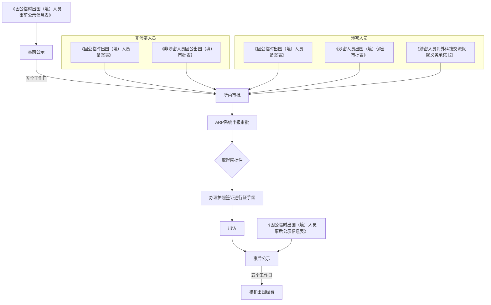

# 关于调整因公出国（境）流程的通知（试行）

> 本稿由源包的4页通知校订稿制作脱敏派生版本；源校订日期为2026-10-23，本轮未重新校订。含联系人信息的原 PDF 不在本包内，需要正式原文时另行取得授权。正文转录保留原文的机构称谓、表单名称、份数及审批关系，仅合并排版换行、统一空格。流程图和查询表属于结构化重建，不能替代对应页正文。原件未见落款日期、施行日期或有效期，本稿不判断其现行效力。联系人及联系信息已删除，以当前任务确认结果为准。

## 查询入口

| 要查的事项 | 定位 | 原文关键条件 |
| --- | --- | --- |
| 出访前何时公示、由谁公示 | [第 1 页：一、事前公示](#p1-before) | 有出访意向后提交公示表及邀请函电子版；科技处国际合作主管初审通过后上传所内网；不少于五个工作日 |
| 何时能办理所内审批 | [第 1 页：二、所内审批起句](#p1-internal) | 事前公示满五个工作日后无异议 |
| 非涉密人员审批及备案 | [第 2 页：1. 非涉密出访人](#p2-nonsecret) | 部门主任审批 → 人力资源处审批备案表 → 科技处国际合作主管盖所章；备案表一式两份 |
| 外籍员工是否办理备案表 | [第 2 页：1（5）](#p2-nonsecret) | 外籍员工不需办理《因公临时出国（境）人员备案表》；原文未豁免其他手续 |
| 涉密人员审批及备案 | [第 2 页：2. 涉密出访人](#p2-secret) | 部门主任 → 人力资源处 → 科技处 → 保密委先后审批；其后另办备案表审批 |
| ARP 申报与院批件 | [第 3 页：三、ARP 系统申报审批](#p3-arp) | 所内审批通过后由部门秘书在线填报；部门主任 → 科技处负责人、所领导 → 院国际合作局 |
| 护照、签证、港澳通行证 | [第 3 页：四](#p3-documents) | 科技处国际合作主管收到《出国及赴港澳批件》后通知并协助办理 |
| 回国（境）后公示 | [第 3 页：六](#p3-after) | 提交事后公示表电子版；科技处国际合作主管上传所内网；不少于五个工作日 |
| 何时核销、由谁审核、交何材料 | [第 3 页：七](#p3-expenses) | 事后公示满五个工作日后无异议；部门秘书整理票据，科技处国际合作主管审核、填核销表并附批件，部门秘书送财务资产处 |
| 表单附件编号 | [第 4 页：附件目录](#p4-attachments) | 附件 1.1、1.2、2、3、4.1、4.2、5 |
| 涉密审批表名称为什么不同 | [原文名称差异](#name-differences) | 第 1 页图示、第 2 页正文、第 4 页附件目录用名不完全一致，分别保留 |

## PDF 第 1 页

[核对原 PDF 本页](../attachments/外事流程通知-OCR.md#page=1)。

### 正文转录

**关于调整因公出国（境）流程的通知（试行）**

根据院国际合作局《关于因公临时出国进行事前和事后公示的通知》（际字[2013]12号）和《关于办理“因公临时出国人员备案表”的通知》要求，我所因公出国（境）流程调整如下：

### 流程图重建

以下按照第 1 页原图重建。左右两组是“所内审批”所需材料的身份分支；“取得院批件”虽在原图中为菱形，但没有是/否箭头，不能把它解释为已明确给出退回或拒绝分支。图中只标“五个工作日”，正文进一步限定“公示满五个工作日后无异议”。

图示的材料与步骤对应关系：

| 身份/步骤 | 原图列出的表单或动作 | 后续依赖 |
| --- | --- | --- |
| 事前公示 | 《因公临时出国（境）人员事前公示信息表》 | 五个工作日 → 所内审批 |
| 非涉密人员的所内审批 | 《因公临时出国（境）人员备案表》；《非涉密人员因公出国（境）审批表》 | 所内审批 → ARP 系统申报审批 |
| 涉密人员的所内审批 | 《因公临时出国（境）人员备案表》；《涉密人员出国（境）保密审批表》；《涉密人员对外科技交流保密义务承诺书》 | 所内审批 → ARP 系统申报审批 |
| 院批件及证件 | ARP 系统申报审批 → 取得院批件 → 办理护照签证通行证手续 | 办理手续 → 出访 |
| 事后公示 | 出访后提交《因公临时出国（境）人员事后公示信息表》 | 五个工作日 → 核销出国经费 |

### 一、事前公示

1. 出访人有出访意向后，填写《因公临时出国（境）人员事前公示信息表》，并将该表和邀请函电子版发送至科技处国际合作主管处；
2. 科技处国际合作主管初审《因公临时出国（境）人员事前公示信息表》通过后，将该表和邀请函电子版上传至所内网进行公示。公示期限不少于五个工作日。

### 二、所内审批

如出访人所提交《因公临时出国（境）人员事前公示信息表》公示满五个工作日后无异议，出访人办理所内审批手续：

本节在第 2 页续列非涉密、涉密两类手续。

### 本页查询关键词

事前公示；邀请函电子版；科技处国际合作主管；所内网；不少于五个工作日；满五个工作日后无异议；非涉密；涉密；ARP；院批件；事后公示；核销出国经费。

## PDF 第 2 页

[核对原 PDF 本页](../attachments/外事流程通知-OCR.md#page=2)。

### 正文转录：二、所内审批（续）

#### 1. 非涉密出访人

（1）出访人填写《非涉密人员因公出国（境）审批表》一份，送交部门主任审批；

（2）部门主任审批通过后，出访人填写《因公临时出国（境）人员备案表》一式两份，送交人力资源处审批；

（3）人力资源处审批通过后，出访人将《非涉密人员因公出国（境）审批表》一份和《因公临时出国（境）人员备案表》一式两份送交至科技处国际合作主管处；

（4）《因公临时出国（境）人员备案表》由科技处国际合作主管盖所章后，一份送交人力资源处备案，一份由科技处留存。

（5）注：外籍员工不需办理《因公临时出国（境）人员备案表》。

#### 2. 涉密出访人

（1）出访人填写《涉密人员因公出国（境）保密审批表》和《涉密人员对外科技交流保密义务承诺书》一份，先后送交部门主任、人力资源处、科技处、保密委审批；

（2）部门主任、人力资源处、科技处、保密委审批通过后，出访人填写《因公临时出国（境）人员备案表》一式两份，送交人力资源处审批；

（3）人力资源处审批通过后，出访人将《涉密人员因公出国（境）保密审批表》和《涉密人员对外科技交流保密义务承诺书》一份，以及《因公临时出国（境）人员备案表》一式两份送交至科技处国际合作主管处。

（4）《因公临时出国（境）人员备案表》由科技处国际合作主管盖所章后，一份送交人力资源处备案，一份由科技处留存。

### 三、ARP 系统申报审批

本节标题在第 2 页末，条款从第 3 页开始。

### 所内审批流程查询表（依据本页正文重建）

| 身份 | 先后步骤 | 表单及份数 | 审批/收件人及去向 |
| --- | --- | --- | --- |
| 非涉密 | 1 | 《非涉密人员因公出国（境）审批表》一份 | 出访人填写 → 部门主任审批 |
| 非涉密 | 2；须在步骤 1 审批通过后 | 《因公临时出国（境）人员备案表》一式两份 | 出访人填写 → 人力资源处审批 |
| 非涉密 | 3；须在人力资源处审批通过后 | 审批表一份＋备案表一式两份 | 出访人送科技处国际合作主管处 |
| 非涉密 | 4 | 备案表一式两份 | 科技处国际合作主管盖所章 → 一份人力资源处备案、一份科技处留存 |
| 非涉密中的外籍员工 | 原文另列的例外 | 不需办理备案表 | 仅此表获豁免；未写其他手续豁免 |
| 涉密 | 1 | 《涉密人员因公出国（境）保密审批表》和《涉密人员对外科技交流保密义务承诺书》一份（按原文表述） | 出访人填写 → 部门主任 → 人力资源处 → 科技处 → 保密委先后审批 |
| 涉密 | 2；须在前述四方审批通过后 | 《因公临时出国（境）人员备案表》一式两份 | 出访人填写 → 人力资源处审批 |
| 涉密 | 3；须在人力资源处审批通过后 | 保密审批表和承诺书一份（按原文表述），以及备案表一式两份 | 出访人送科技处国际合作主管处 |
| 涉密 | 4 | 备案表一式两份 | 科技处国际合作主管盖所章 → 一份人力资源处备案、一份科技处留存 |

### 本页查询关键词

非涉密出访人；涉密出访人；外籍员工；一份；一式两份；部门主任；人力资源处；科技处；保密委；先后审批；备案表；盖所章；备案；留存；保密审批表；保密义务承诺书。

## PDF 第 3 页

[核对原 PDF 本页](../attachments/外事流程通知-OCR.md#page=3)。

### 正文转录

### 三、ARP 系统申报审批（续）

1. 出访人上述所内审批通过后，出访人通过部门秘书在线填报 ARP 出国（境）申请，提交部门主任审批。
2. 部门主任 ARP 审批通过后，科技处国际合作主管受理 ARP 申请，提交科技处负责人、所领导审批后，报送院国际合作局审批；
3. 院国际合作局审批通过后，通过 ARP 下发《出国及赴港澳批件》至科技处国际合作主管处。

### 四、办理因公护照、签证、港澳通行证等手续

科技处国际合作主管收到院国际合作局下发的《出国及赴港澳批件》后，通知出访人，并协助出访人办理因公护照、签证、港澳通行证等手续。

### 五、出访

出访人持有效因公签证、港澳通行证等出国（境）执行出访任务。出访任务结束后，出访人按期返回国（境）内。

### 六、事后公示

1. 出访任务结束、返回国（境）后，出访人填写《因公临时出国（境）人员事后公示信息表》，将该表电子版发送至科技处国际合作主管处；
2. 科技处国际合作主管将该表上传至所内网进行公示。公示期限不少于五个工作日。

### 七、核销出国经费

1. 如出访人所提交《因公临时出国（境）人员事后公示信息表》公示满五个工作日后无异议，部门秘书整理粘贴出访票据，送交科技处国际合作主管处审核。
2. 科技处国际合作主管审核出访票据，填写《临时出国人员外汇开支核销表》并附上《出国及赴港澳批件》，交还至部门秘书处。
3. 部门秘书送交《临时出国人员外汇开支核销表》和《出国及赴港澳批件》至财务资产处核销出访经费。

### 后续流程查询表（依据本页正文重建）

| 顺序 | 进入条件 | 经办/审批关系 | 材料与结果 |
| --- | --- | --- | --- |
| ARP 申报 | 上述所内审批通过 | 出访人通过部门秘书在线填报 → 部门主任审批 | ARP 出国（境）申请 |
| ARP 进一步审批 | 部门主任 ARP 审批通过 | 科技处国际合作主管受理 → 提交科技处负责人、所领导审批 → 报院国际合作局审批 | 审批通过后通过 ARP 下发《出国及赴港澳批件》至科技处国际合作主管处 |
| 办理证件 | 科技处国际合作主管收到院下发批件 | 科技处国际合作主管通知出访人并协助 | 因公护照、签证、港澳通行证等手续 |
| 出访及返回 | 持有效因公签证、港澳通行证等 | 出访人执行任务并按期返回 | 返回国（境）内 |
| 事后公示 | 出访任务结束、返回国（境）后 | 出访人提交电子表 → 科技处国际合作主管上传所内网 | 《因公临时出国（境）人员事后公示信息表》；公示不少于五个工作日 |
| 票据审核 | 事后公示满五个工作日后无异议 | 部门秘书整理粘贴票据 → 科技处国际合作主管审核 | 出访票据 |
| 准备核销材料 | 科技处国际合作主管审核票据 | 科技处国际合作主管填写核销表并附批件 → 交还部门秘书 | 《临时出国人员外汇开支核销表》＋《出国及赴港澳批件》 |
| 核销经费 | 上述核销材料准备后 | 部门秘书送交 → 财务资产处核销 | 核销出访经费 |

原文未为 ARP、证件办理、票据审核或财务核销规定办理天数；不得由两次公示的“五个工作日”推导这些环节的时限。

### 本页查询关键词

ARP 出国（境）申请；部门秘书；部门主任；科技处负责人；所领导；院国际合作局；出国及赴港澳批件；因公护照；签证；港澳通行证；按期返回；事后公示；不少于五个工作日；满五个工作日后无异议；出访票据；临时出国人员外汇开支核销表；财务资产处。

## PDF 第 4 页

[核对原 PDF 本页](../attachments/外事流程通知-OCR.md#page=4)。

### 正文转录：联系人

联系人：外事经办人

电话：待当前任务按财务确认信息填写

邮箱：（邮箱待当前任务确认）

### 附件目录（按原件名称转录）

| 原件编号 | 原件附件名称 |
| --- | --- |
| 附件 1.1 | 因公临时出国（境）人员事前公示信息表 |
| 附件 1.2 | 因公临时出国（境）人员事后公示信息表 |
| 附件 2 | 因公临时出国（境）人员备案表 |
| 附件 3 | 非涉密人员因公出国（境）审批表 |
| 附件 4.1 | 涉密人员因公出国（境）审批表 |
| 附件 4.2 | 涉密人员对外科技交流保密义务承诺书 |
| 附件 5 | 各国家和地区住宿费、伙食费、公杂费开支标准表 |

本页只是附件目录，没有附件表内字段，也没有国家地区的具体金额或币种；费用标准需核对对应原始附件，不能从本通知推算。

### 本页查询关键词

外事经办人；（历史编号或联系方式已移除）；（邮箱待当前任务确认）；附件 1.1；附件 1.2；附件 2；附件 3；附件 4.1；附件 4.2；附件 5；事前公示信息表；事后公示信息表；备案表；非涉密人员审批表；涉密人员审批表；保密义务承诺书；住宿费；伙食费；公杂费。

## 原文名称差异与使用边界

| 位置 | 原件名称 | 处理方式 |
| --- | --- | --- |
| 第 1 页流程图，涉密人员材料 | 《涉密人员出国（境）保密审批表》 | 图示重建保留该名称 |
| 第 2 页“2. 涉密出访人”（1）、（3） | 《涉密人员因公出国（境）保密审批表》 | 正文转录和正文查询表保留该名称 |
| 第 4 页附件 4.1 | 涉密人员因公出国（境）审批表 | 附件目录保留该名称；未擅自增补“保密” |

- 原文正文使用“科技处国际合作主管”“科技处负责人”“所领导”“院国际合作局”等称谓。本稿没有依据其他文件补写机构或职务全称。
- 第 2 页涉密条款两次出现“保密审批表和承诺书一份”，本稿按原文保留，未改写为“各一份”。
- 原件给出的两项量化期限都是公示的五个工作日；没有具体出访日期、文件签发日期、金额、币种或汇率。
- 这是包内通知原文的可查询校对稿；未联网核验现行制度，也未把附件目录当作附件正文。
